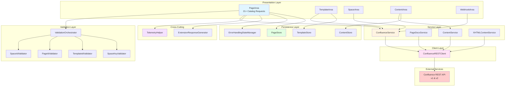
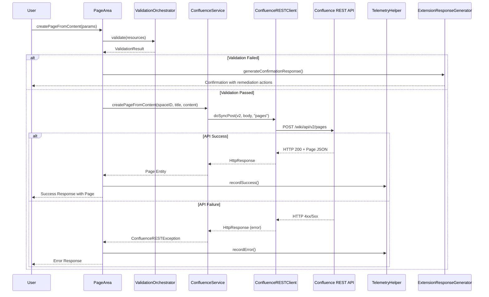
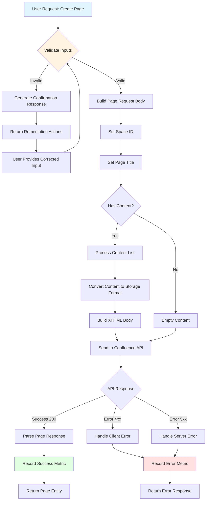
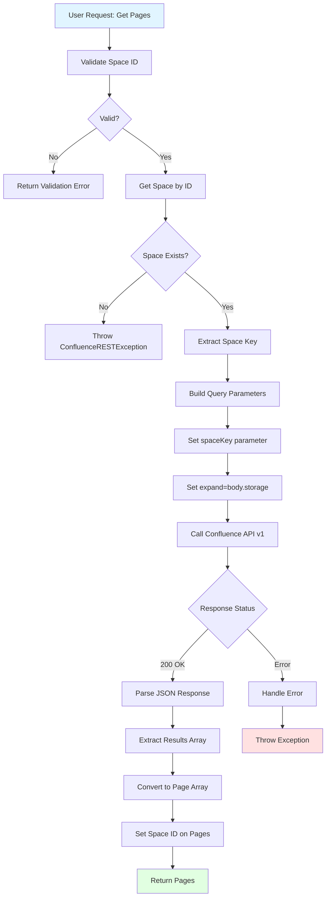
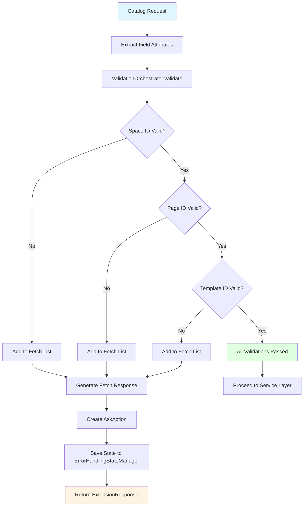
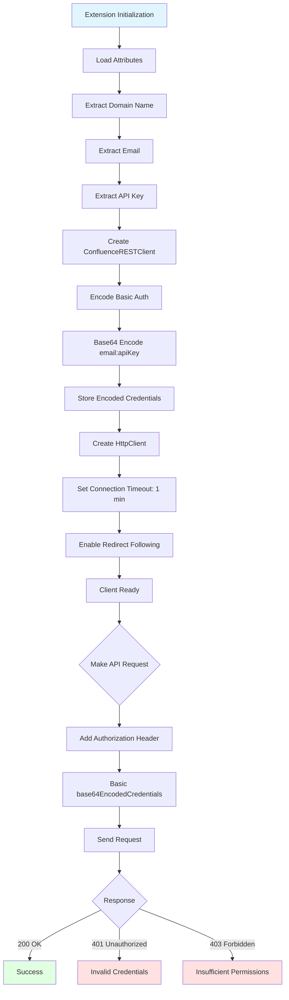

# Confluence Extension - Architecture Documentation

## 📋 Table of Contents
1. [Overview](#overview)
2. [Architecture Layers](#architecture-layers)
3. [Component Diagrams](#component-diagrams)
4. [Data Flow](#data-flow)
5. [Performance Limitations](#performance-limitations)
6. [Error Scenarios](#error-scenarios)
7. [Security Considerations](#security-considerations)
8. [Monitoring & Observability](#monitoring--observability)
9. [Future Enhancements](#future-enhancements)

---

## 1. Overview

The **Confluence Extension** is a Java 21-based integration that enables seamless interaction with Atlassian Confluence through the Confluence REST API. It provides comprehensive content management capabilities including page creation, template management, space operations, and content manipulation.

### Key Features
- ✅ **Page Management**: Create, update, retrieve, and query pages
- ✅ **Template Operations**: Manage and apply Confluence templates
- ✅ **Space Management**: Query and manage Confluence spaces
- ✅ **Content Operations**: Create and manipulate structured content
- ✅ **Webhook Support**: Create webhooks for event notifications
- ✅ **Document Conversion**: Convert pages to DOCX format
- ✅ **Error Handling**: Comprehensive validation and remediation flows
- ✅ **Telemetry**: Built-in monitoring and performance tracking

### Technology Stack
- **Java Version**: Java 21
- **Build Tool**: Gradle
- **Framework**: Krista Extension Framework
- **Dependency Injection**: HK2
- **External API**: Confluence REST API (v1 & v2)
- **Authentication**: Basic Authentication (Email + API Key)
- **HTTP Client**: Java 11+ HttpClient
- **JSON Processing**: Gson
- **HTML Processing**: Jsoup
- **Document Processing**: Apache POI (DOCX)
- **Testing**: JUnit 5, Mockito

---

## 2. Architecture Layers

The extension follows a **5-layer architecture** pattern for separation of concerns and maintainability:

### 2.1 Presentation Layer (Catalog)
**Location**: `com.kristasoft.extensions.essentials.collaboration.confluence.catalog`

**Components**:
- **PageArea**: Main catalog area exposing 21+ page-related catalog requests
  - `createPageFromContent()` - Create pages with structured content
  - `createPageFromTemplate()` - Create pages from templates
  - `updatePageByContent()` - Update existing pages
  - `updatePageFromTemplate()` - Update pages using templates
  - `getPageByID()` - Retrieve page by ID
  - `getPagesInSpace()` - Get all pages in a space
  - `getPageInSpace()` - Get specific page in space
  - `getDirectChildPagesOfPage()` - Get immediate children
  - `getDirectChildPagesOfSpace()` - Get top-level pages
  - `getAllNestedDescendantsOfPage()` - Get all descendants recursively
  - `getAncestorsOfPage()` - Get page hierarchy
  - `checkIfPageHasChildren()` - Check for child pages
  - `exportPageToDocx()` - Export page to Word document

- **TemplateArea**: Template management operations
  - `getTemplateByID()` - Retrieve template by ID
  - `getTemplatesBySpaceID()` - Get all templates in space

- **SpaceArea**: Space management operations
  - `getSpaces()` - List all accessible spaces
  - `getSpaceById()` - Retrieve specific space

- **ContentArea**: Content manipulation operations
  - Content creation and formatting
  - XHTML content processing

- **WebhookArea**: Webhook management
  - `createWebhook()` - Create event webhooks

**Responsibilities**:
- Request parameter validation
- Input transformation
- Response formatting
- Error handling orchestration
- Telemetry tracking

### 2.2 Service Layer
**Location**: `com.kristasoft.extensions.essentials.collaboration.confluence.service`

**Components**:
- **ConfluenceService**: Unified service implementing all interfaces
  - Implements PageService, TemplateService, SpaceService
  - Core business logic for all operations
  - API response transformation
  - Error handling and exception translation

- **PageService** (Interface): Page-specific operations
  - Page CRUD operations
  - Page hierarchy management
  - Page search and retrieval

- **TemplateService** (Interface): Template operations
  - Template retrieval
  - Template application

- **SpaceService** (Interface): Space operations
  - Space listing
  - Space retrieval

- **PageDocxService**: Document conversion service
  - Convert Confluence pages to DOCX format
  - HTML to Word conversion
  - Formatting preservation

- **ContentService**: Content manipulation
  - Content creation
  - Content formatting

- **XHTMLContentService**: XHTML processing
  - XHTML generation
  - Content transformation

**Responsibilities**:
- Business logic execution
- Data transformation
- Confluence API interaction
- Response parsing
- Exception handling

### 2.3 Client Layer
**Location**: `com.kristasoft.extensions.essentials.collaboration.confluence.client`

**Components**:
- **ConfluenceRESTClient**: HTTP client for Confluence API
  - Synchronous GET/POST/PUT/DELETE operations
  - Asynchronous GET operations
  - Basic authentication handling
  - Request/response logging
  - Connection timeout management (1 minute default)
  - Automatic redirect following

**Responsibilities**:
- HTTP request construction
- Authentication header injection
- Request execution
- Response handling
- Network error handling
- Connection pooling

### 2.4 Persistence Layer
**Location**: `com.kristasoft.extensions.essentials.collaboration.confluence.catalog.stores`

**Components**:
- **PageStore**: Stores page metadata and state
- **TemplateStore**: Stores template information
- **ContentStore**: Stores content data
- **ErrorHandlingStateManager**: Manages validation and error states
  - Stores validation results
  - Manages remediation context
  - Uses KeyValueStore for persistence

**Responsibilities**:
- State management
- Data persistence
- Cache management
- Error state tracking

### 2.5 Cross-Cutting Concerns

#### Validation Layer
**Location**: `com.kristasoft.extensions.essentials.collaboration.confluence.catalog.validators`

**Components**:
- **ValidationOrchestrator**: Coordinates validation across validators
- **SpaceIdValidator**: Validates space IDs
- **SpaceKeyValidator**: Validates space keys
- **SpaceNameValidator**: Validates space names
- **PageIdValidator**: Validates page IDs
- **TemplateIdValidator**: Validates template IDs
- **Validator** (Interface): Base validator contract

**Validation Strategy Pattern**:
- Strategy-based validation with pluggable validators
- Dynamic field attribute extraction
- Centralized validation orchestration

#### Error Handling Layer
**Location**: `com.kristasoft.extensions.essentials.collaboration.confluence.catalog.errorhandlers`

**Components**:
- **ErrorHandlingStateManager**: Manages error states
- **ExtensionResponseGenerator**: Generates error responses
  - Confirmation responses for validation failures
  - Fetch responses for missing data
  - Validation error responses

#### Telemetry Layer
**Location**: `com.kristasoft.extensions.essentials.collaboration.confluence.utils`

**Components**:
- **TelemetryHelper**: Records metrics and performance data
  - Success/failure counters
  - Duration tracking
  - Retry attempt tracking
  - Error tracking

---

## 3. Component Diagrams

### 3.1 High-Level Architecture




### 3.2 Component Interaction Flow



---

## 4. Data Flow

### 4.1 Create Page from Content Flow




### 4.2 Get Pages in Space Flow



### 4.3 Error Handling & Validation Flow



### 4.4 Authentication Flow



---

## 5. Performance Limitations

### 5.1 Confluence REST API Rate Limits

Atlassian Confluence Cloud enforces **rate limiting** to ensure service stability:

| Resource Type | Rate Limit | Time Window | Impact |
|--------------|------------|-------------|---------|
| **Per User** | ~200 requests | 1 minute | User-specific operations |
| **Per App** | Varies by plan | 1 minute | Application-wide operations |
| **Concurrent Requests** | 10 requests | Per connection | Parallel request limit |

**Rate Limit Response**:
- HTTP Status: `429 Too Many Requests`
- Header: `Retry-After: <seconds>`
- Recommended Action: Exponential backoff

**Extension Handling**:
- ❌ No automatic retry mechanism
- ❌ No rate limit detection
- ❌ No request queuing
- ⚠️ Manual retry required

### 5.2 Network Latency & Timeouts

**Default Timeout Configuration**:
- **Connection Timeout**: 60 seconds
- **Read Timeout**: 60 seconds (implicit)
- **Write Timeout**: 60 seconds (implicit)

**Latency Factors**:
- Confluence API response time: 200-3000ms (varies by operation)
- Network round-trip time: 50-300ms
- TLS handshake: 100-200ms (first request)

**High-Latency Operations**:
| Operation | Avg Latency | Max Latency | Notes |
|-----------|-------------|-------------|-------|
| `createPageFromContent` | 800ms | 4000ms | Includes content processing |
| `createPageFromTemplate` | 1000ms | 5000ms | Template expansion overhead |
| `getPagesInSpace` | 600ms | 3000ms | Depends on page count |
| `getAllNestedDescendantsOfPage` | 1500ms | 8000ms | Recursive API calls |
| `exportPageToDocx` | 2000ms | 10000ms | Document conversion overhead |
| `updatePageByContent` | 700ms | 3500ms | Content validation |

### 5.3 Memory Constraints

**Large Result Sets**:
- **No Pagination**: Extension loads all results in memory
- **Memory per Page**: ~5-10 KB (varies with content)
- **Memory per Template**: ~3-5 KB

**Memory Impact**:
| Operation | Typical Memory | Peak Memory | Risk |
|-----------|---------------|-------------|------|
| `getPagesInSpace` (100 pages) | 1 MB | 3 MB | Medium |
| `getAllNestedDescendantsOfPage` (500 pages) | 5 MB | 15 MB | High |
| `exportPageToDocx` | 10 MB | 50 MB | High |
| Template processing | 500 KB | 2 MB | Low |

**Mitigation**:
- ❌ No pagination support
- ❌ No streaming for large results
- ❌ No memory pooling
- ⚠️ Risk of OutOfMemoryError with large spaces


### 5.4 Concurrent Request Limitations

**HttpClient Configuration**:
- **Connection Pool**: Default Java HttpClient pool
- **Max Connections**: Not explicitly configured
- **Connection Reuse**: Enabled via HTTP/1.1 keep-alive

**Concurrency Constraints**:
- ❌ No explicit connection pool management
- ❌ No request throttling
- ❌ No queue management
- ⚠️ Risk of connection exhaustion with high concurrency

---

## 6. Error Scenarios

### 6.1 Validation Errors

#### 6.1.1 Invalid Space ID
**Scenario**: User provides non-existent or invalid space ID

**Detection**:
- `SpaceIdValidator` queries Confluence API
- HTTP 404 response indicates invalid space

**Response**:
```json
{
  "error": {
    "message": "Space not found",
    "type": "INPUT_ERROR",
    "actions": [
      {
        "type": "ASK",
        "field": "Space ID",
        "fetchRequest": "getSpaces"
      }
    ]
  }
}
```

**User Experience**:
- If `allowRetry = true`: User prompted to select valid space
- If `allowRetry = false`: Error returned immediately

#### 6.1.2 Invalid Page ID
**Scenario**: User provides non-existent page ID

**Detection**:
- `PageIdValidator` queries Confluence API
- HTTP 404 response indicates invalid page

**Response**:
```json
{
  "error": {
    "message": "Page not found",
    "type": "INPUT_ERROR",
    "actions": [
      {
        "type": "ASK",
        "field": "Page ID",
        "fetchRequest": "getPagesInSpace"
      }
    ]
  }
}
```

#### 6.1.3 Invalid Template ID
**Scenario**: User provides non-existent template ID

**Detection**:
- `TemplateIdValidator` queries Confluence API
- HTTP 404 response indicates invalid template

**Response**: Fetch action to retrieve valid templates

### 6.2 Authentication Errors

#### 6.2.1 Invalid Credentials
**Scenario**: Incorrect email or API key

**HTTP Response**:
- Status: `401 Unauthorized`
- Body: `{"message": "Authentication failed"}`

**Extension Handling**:
```java
if (response.statusCode() == HttpURLConnection.HTTP_UNAUTHORIZED) {
    throw new ConfluenceRESTException(
        "Invalid credentials. Please verify your email and API key."
    );
}
```

**User Impact**:
- Extension initialization fails
- `validateAttributes()` throws exception
- User must reconfigure extension

#### 6.2.2 Insufficient Permissions
**Scenario**: Valid credentials but insufficient permissions

**HTTP Response**:
- Status: `403 Forbidden`
- Body: `{"message": "Insufficient permissions"}`

**Extension Handling**:
```java
if (response.statusCode() == HttpURLConnection.HTTP_FORBIDDEN) {
    throw new ConfluenceRESTException(
        "Insufficient permissions. Please ensure your account has the required access."
    );
}
```

**Common Causes**:
- User lacks space permissions
- User lacks page creation permissions
- User lacks template access

### 6.3 Network Errors

#### 6.3.1 Connection Timeout
**Scenario**: Network connectivity issues or slow Confluence instance

**Exception**:
```java
java.net.http.HttpTimeoutException: request timed out
```

**Extension Handling**:
```java
catch (IOException e) {
    throw new ConfluenceRESTException(
        "Unable to connect to Confluence. Please verify your network connection and Confluence URL, then try again. Details: " + e.getMessage()
    );
}
```

**Mitigation**:
- Default timeout: 60 seconds
- ❌ No automatic retry
- ⚠️ User must manually retry

#### 6.3.2 DNS Resolution Failure
**Scenario**: Invalid domain name or DNS issues

**Exception**:
```java
java.net.UnknownHostException: <domain-name>
```

**Extension Handling**: Wrapped in `ConfluenceRESTException`

**User Action**: Verify domain name configuration

#### 6.3.3 SSL/TLS Errors
**Scenario**: Certificate validation failures

**Exception**:
```java
javax.net.ssl.SSLHandshakeException
```

**Common Causes**:
- Expired SSL certificate
- Self-signed certificate
- Certificate chain issues

### 6.4 Confluence API Errors

#### 6.4.1 Rate Limiting (429)
**Scenario**: Too many requests in short time window

**HTTP Response**:
- Status: `429 Too Many Requests`
- Header: `Retry-After: 60`

**Extension Handling**:
- ❌ No automatic detection
- ❌ No exponential backoff
- ⚠️ Exception thrown to user

**Recommended Enhancement**:
```java
if (response.statusCode() == 429) {
    int retryAfter = Integer.parseInt(response.headers().firstValue("Retry-After").orElse("60"));
    Thread.sleep(retryAfter * 1000);
    // Retry request
}
```

#### 6.4.2 Bad Request (400)
**Scenario**: Invalid request body or parameters

**HTTP Response**:
- Status: `400 Bad Request`
- Body: Detailed error message

**Common Causes**:
- Invalid JSON structure
- Missing required fields
- Invalid field values
- Malformed XHTML content

**Extension Handling**:
```java
if (response.statusCode() == HttpURLConnection.HTTP_BAD_REQUEST) {
    throw new ConfluenceRESTException(
        "Invalid request: " + response.body()
    );
}
```

#### 6.4.3 Server Error (500)
**Scenario**: Confluence internal server error

**HTTP Response**:
- Status: `500 Internal Server Error`
- Body: Error details

**Extension Handling**:
- Exception thrown with error details
- ❌ No automatic retry
- User must retry manually

#### 6.4.4 Service Unavailable (503)
**Scenario**: Confluence maintenance or overload

**HTTP Response**:
- Status: `503 Service Unavailable`
- Header: `Retry-After: <seconds>`

**Extension Handling**:
- Exception thrown
- ❌ No retry mechanism
- User must wait and retry

### 6.5 Business Logic Errors

#### 6.5.1 Duplicate Page Title
**Scenario**: Page with same title already exists in space

**HTTP Response**:
- Status: `400 Bad Request`
- Body: `{"message": "A page with this title already exists"}`

**Extension Handling**: Exception with error message

**User Action**: Choose different title or update existing page

#### 6.5.2 Invalid Content Format
**Scenario**: Malformed XHTML or unsupported content

**HTTP Response**:
- Status: `400 Bad Request`
- Body: Content validation error

**Extension Handling**: Exception with validation details

**Common Causes**:
- Unclosed HTML tags
- Invalid XHTML structure
- Unsupported HTML elements
- Invalid macro syntax

#### 6.5.3 Template Variable Mismatch
**Scenario**: Template requires variables not provided

**Extension Handling**:
- Template expansion fails
- Missing variables not replaced
- ⚠️ No validation before API call

### 6.6 Data Conversion Errors

#### 6.6.1 DOCX Export Failure
**Scenario**: Page content cannot be converted to DOCX

**Causes**:
- Complex macros not supported
- Embedded content issues
- Large images
- Unsupported formatting

**Extension Handling**:
```java
catch (Exception e) {
    throw new RuntimeException("Failed to export page to DOCX: " + e.getMessage());
}
```

#### 6.6.2 JSON Parsing Errors
**Scenario**: Unexpected API response format

**Exception**:
```java
com.google.gson.JsonSyntaxException
```

**Extension Handling**: Exception propagated to user

**Causes**:
- API version mismatch
- Malformed response
- Unexpected null values

---

## 7. Security Considerations

### 7.1 Authentication & Authorization

**Authentication Method**: Basic Authentication
- Email + API Key encoded in Base64
- Transmitted in `Authorization` header
- ✅ HTTPS required for security

**API Key Management**:
- ✅ Stored as secured field (`@Field.Text(isSecured = true)`)
- ✅ Not logged in plain text
- ⚠️ Stored in extension attributes (encrypted by platform)

**Authorization**:
- Confluence enforces permissions at API level
- Extension respects Confluence RBAC
- No additional authorization layer in extension

### 7.2 Data Protection

**Data in Transit**:
- ✅ HTTPS enforced for all API calls
- ✅ TLS 1.2+ required
- ✅ Certificate validation enabled

**Data at Rest**:
- Extension stores minimal data
- Page/Template/Space metadata cached temporarily
- ❌ No encryption for cached data
- ⚠️ Sensitive content in memory during processing

**Sensitive Data Handling**:
- API keys: Secured field, not logged
- Page content: Processed in memory, not persisted
- User emails: Logged for debugging (⚠️ PII concern)

### 7.3 Input Validation & Sanitization

**Validation Layers**:
1. **Field-level validation**: Required fields, data types
2. **Business validation**: Space/Page/Template existence
3. **API validation**: Confluence validates request body

**Sanitization**:
- ❌ No explicit HTML sanitization
- ⚠️ Relies on Confluence API for content validation
- ⚠️ Risk of XSS if Confluence validation bypassed

**Injection Prevention**:
- ✅ Uses parameterized API calls
- ✅ JSON serialization via Gson (prevents injection)
- ❌ No explicit SQL injection prevention (not applicable)

### 7.4 API Security

**API Key Exposure Risks**:
- ✅ Not logged in plain text
- ✅ Not exposed in error messages
- ⚠️ Visible in memory dumps
- ⚠️ Transmitted in every request header

**Request Security**:
- ✅ HTTPS only
- ✅ Basic Auth header
- ❌ No request signing
- ❌ No additional encryption layer

**Response Validation**:
- ✅ HTTP status code validation
- ✅ JSON structure validation
- ❌ No response signature verification
- ❌ No content integrity checks

### 7.5 Compliance & Privacy

**GDPR Considerations**:
- ⚠️ User emails logged (PII)
- ⚠️ Page content processed (may contain PII)
- ❌ No data retention policy
- ❌ No data deletion mechanism

**Audit Logging**:
- ✅ All API calls logged with timestamps
- ✅ Success/failure logged
- ⚠️ Request parameters logged (may contain sensitive data)
- ❌ No centralized audit trail

**Data Residency**:
- Depends on Confluence Cloud region
- Extension does not control data location
- No data stored outside Confluence

---

## 8. Monitoring & Observability

### 8.1 Telemetry Metrics

**TelemetryHelper** tracks the following metrics:

#### Success Metrics
```java
telemetryHelper.recordSuccess(
    "confluence.createPageFromContent",
    startTime,
    Map.of("space_id", spaceId, "page_id", pageId)
);
```

**Tracked Operations**:
- `confluence.createPageFromContent`
- `confluence.createPageFromTemplate`
- `confluence.updatePageByContent`
- `confluence.updatePageFromTemplate`
- `confluence.getPageById`
- `confluence.getPagesInSpace`
- `confluence.getSpaces`
- `confluence.getTemplateById`

**Metrics Collected**:
- **Count**: Number of successful operations
- **Duration**: Time taken (ms)
- **Tags**: Operation-specific metadata

#### Error Metrics
```java
telemetryHelper.recordError(
    "confluence.createPageFromContent",
    startTime,
    exception,
    Map.of("space_id", spaceId, "error_type", "VALIDATION_ERROR")
);
```

**Error Categories**:
- Validation errors
- Authentication errors
- Network errors
- API errors
- Business logic errors

#### Retry Metrics
```java
telemetryHelper.recordRetryPrompted(
    "confluence.createPageFromContent",
    startTime,
    Map.of("validation_count", "3")
);
```

**Retry Tracking**:
- Number of validation failures
- Retry prompts issued
- User retry attempts

### 8.2 Logging Strategy

**Log Levels**:
- **INFO**: Operation start/end, API calls, success
- **DEBUG**: Validation details, intermediate steps
- **WARN**: Validation failures, retry prompts
- **ERROR**: Exceptions, API errors, failures

**Key Log Points**:
```java
LOGGER.info("→ createPageFromContent: Starting operation with pageTitle: {}, spaceID: {}", pageTitle, spaceID);
LOGGER.debug("→ createPageFromContent: Validation completed with {} results", validationResults.size());
LOGGER.warn("→ createPageFromContent: Validation failed with {} errors", validationResults.size());
LOGGER.error("→ createPageFromContent: Exception occurred - {}", cause.getMessage(), cause);
```

**Structured Logging**:
- Operation name prefix (→)
- Contextual parameters
- Correlation IDs (state IDs for error handling)

### 8.3 Health Checks

**Extension Health**:
- `testConnection()`: Validates credentials and connectivity
- `validateAttributes()`: Verifies configuration

**Health Check Flow**:
1. Load extension attributes
2. Create REST client
3. Call Confluence API (`GET /spaces`)
4. Validate HTTP 200 response

**Health Indicators**:
- ✅ HTTP 200: Healthy
- ❌ HTTP 401: Authentication failure
- ❌ HTTP 403: Permission issues
- ❌ Timeout: Network issues
- ❌ Exception: Configuration errors

### 8.4 Performance Monitoring

**Key Performance Indicators (KPIs)**:

| Metric | Target | Warning | Critical |
|--------|--------|---------|----------|
| **API Response Time** | < 1s | 1-3s | > 3s |
| **Success Rate** | > 99% | 95-99% | < 95% |
| **Error Rate** | < 1% | 1-5% | > 5% |
| **Validation Failure Rate** | < 5% | 5-10% | > 10% |
| **Retry Rate** | < 10% | 10-20% | > 20% |

**Performance Tracking**:
- Duration tracking for all operations
- API call latency
- Validation overhead
- Error handling overhead

---

## 9. Future Enhancements

### 9.1 High Priority

#### 9.1.1 Retry Mechanism with Exponential Backoff
**Problem**: No automatic retry for transient failures

**Solution**:
```java
@Service
public class ExponentialBackoffRetryExecutor {
    public <T> T executeWithRetry(Supplier<T> operation, RetryConfig config) {
        int attempt = 0;
        while (attempt < config.maxAttempts) {
            try {
                return operation.get();
            } catch (Exception e) {
                if (!isRetryable(e) || attempt == config.maxAttempts - 1) {
                    throw e;
                }
                long delay = config.baseDelay * (long) Math.pow(2, attempt);
                Thread.sleep(Math.min(delay, config.maxDelay));
                attempt++;
            }
        }
    }
}
```

**Benefits**:
- Handle transient network failures
- Respect rate limits (429 responses)
- Improve reliability

#### 9.1.2 Pagination Support
**Problem**: Large result sets cause memory issues

**Solution**:
```java
public PagedResult<Page> getPagesInSpace(String spaceId, int pageSize, String cursor) {
    // Use Confluence API pagination
    // Return cursor for next page
}
```

**Benefits**:
- Reduce memory footprint
- Improve performance for large spaces
- Enable streaming processing

#### 9.1.3 Rate Limit Detection & Handling
**Problem**: No handling for 429 responses

**Solution**:
```java
if (response.statusCode() == 429) {
    int retryAfter = Integer.parseInt(
        response.headers().firstValue("Retry-After").orElse("60")
    );
    telemetryHelper.recordRateLimitHit(retryAfter);
    return retryExecutor.retryAfter(operation, retryAfter);
}
```

**Benefits**:
- Automatic rate limit handling
- Improved user experience
- Reduced manual retries

### 9.2 Medium Priority

#### 9.2.1 Caching Layer
**Problem**: Repeated API calls for same data

**Solution**:
```java
@Service
public class ConfluenceCacheService {
    private final Cache<String, Space> spaceCache;
    private final Cache<String, Page> pageCache;
    
    public Space getSpaceById(String id) {
        return spaceCache.get(id, () -> confluenceService.getSpaceById(id));
    }
}
```

**Configuration**:
- TTL: 5 minutes for spaces
- TTL: 2 minutes for pages
- Max size: 1000 entries

**Benefits**:
- Reduce API calls
- Improve response time
- Lower rate limit impact

#### 9.2.2 Async Operations
**Problem**: Long-running operations block

**Solution**:
```java
@CatalogRequest(type = CatalogRequest.Type.ASYNC)
public CompletableFuture<ExtensionResponse> createPageAsync(...) {
    return CompletableFuture.supplyAsync(() -> {
        return createPageFromContent(...);
    });
}
```

**Benefits**:
- Non-blocking operations
- Better concurrency
- Improved user experience

#### 9.2.3 Bulk Operations
**Problem**: No batch API support

**Solution**:
```java
public List<Page> createPagesInBulk(List<PageRequest> requests) {
    return requests.parallelStream()
        .map(this::createPageFromContent)
        .collect(Collectors.toList());
}
```

**Benefits**:
- Reduce round trips
- Improve performance
- Better resource utilization

### 9.3 Low Priority

#### 9.3.1 Advanced Search
**Problem**: Limited search capabilities

**Solution**:
- CQL (Confluence Query Language) support
- Full-text search
- Advanced filtering

#### 9.3.2 Attachment Management
**Problem**: No attachment support

**Solution**:
- Upload attachments
- Download attachments
- Manage attachment metadata

#### 9.3.3 Comment Management
**Problem**: No comment operations

**Solution**:
- Add comments to pages
- Retrieve comments
- Update/delete comments

#### 9.3.4 Label Management
**Problem**: No label operations

**Solution**:
- Add labels to pages
- Retrieve labels
- Search by labels

#### 9.3.5 Version History
**Problem**: No version management

**Solution**:
- Retrieve page versions
- Compare versions
- Restore previous versions

---

## 10. Appendix

### 10.1 Catalog Request Reference

| Area | Catalog Request | Type | Description |
|------|----------------|------|-------------|
| **Page** | `createPageFromContent` | CHANGE_SYSTEM | Create page with structured content |
| **Page** | `createPageFromTemplate` | CHANGE_SYSTEM | Create page from template |
| **Page** | `updatePageByContent` | CHANGE_SYSTEM | Update page with new content |
| **Page** | `updatePageFromTemplate` | CHANGE_SYSTEM | Update page using template |
| **Page** | `getPageByID` | FETCH_SYSTEM | Retrieve page by ID |
| **Page** | `getPagesInSpace` | FETCH_SYSTEM | Get all pages in space |
| **Page** | `getPageInSpace` | FETCH_SYSTEM | Get specific page in space |
| **Page** | `getDirectChildPagesOfPage` | FETCH_SYSTEM | Get immediate children |
| **Page** | `getDirectChildPagesOfSpace` | FETCH_SYSTEM | Get top-level pages |
| **Page** | `getAllNestedDescendantsOfPage` | FETCH_SYSTEM | Get all descendants recursively |
| **Page** | `getAncestorsOfPage` | FETCH_SYSTEM | Get page hierarchy |
| **Page** | `checkIfPageHasChildren` | FETCH_SYSTEM | Check for child pages |
| **Page** | `exportPageToDocx` | FETCH_SYSTEM | Export page to Word |
| **Template** | `getTemplateByID` | FETCH_SYSTEM | Retrieve template by ID |
| **Template** | `getTemplatesBySpaceID` | FETCH_SYSTEM | Get templates in space |
| **Space** | `getSpaces` | FETCH_SYSTEM | List all spaces |
| **Space** | `getSpaceById` | FETCH_SYSTEM | Retrieve specific space |
| **Webhook** | `createWebhook` | CHANGE_SYSTEM | Create event webhook |

### 10.2 Validator Reference

| Validator | Resource | Validation Method | Error Message |
|-----------|----------|-------------------|---------------|
| `SpaceIdValidator` | SPACE_ID | API call to `/spaces/{id}` | "Space not found" |
| `SpaceKeyValidator` | SPACE_KEY | API call with space key | "Invalid space key" |
| `SpaceNameValidator` | SPACE_NAME | Search by name | "Space not found" |
| `PageIdValidator` | PAGE_ID | API call to `/pages/{id}` | "Page not found" |
| `TemplateIdValidator` | TEMPLATE_ID | API call to `/template/{id}` | "Template not found" |

### 10.3 API Version Reference

| API Version | Base Path | Usage |
|-------------|-----------|-------|
| **v1** | `/wiki/rest/api` | Templates, legacy operations |
| **v2** | `/wiki/api/v2` | Pages, spaces, modern operations |

### 10.4 Error Code Reference

| HTTP Code | Meaning | Extension Handling |
|-----------|---------|-------------------|
| 200 | Success | Parse response, return data |
| 400 | Bad Request | Throw ConfluenceRESTException |
| 401 | Unauthorized | Throw authentication error |
| 403 | Forbidden | Throw permission error |
| 404 | Not Found | Validation failure or exception |
| 429 | Rate Limited | Throw exception (no retry) |
| 500 | Server Error | Throw ConfluenceRESTException |
| 503 | Service Unavailable | Throw ConfluenceRESTException |

### 10.5 Glossary

| Term | Definition |
|------|------------|
| **Catalog Request** | Extension operation exposed to Krista platform |
| **Catalog Area** | Logical grouping of related catalog requests |
| **Extension Response** | Standardized response format for catalog requests |
| **Validation Orchestrator** | Coordinates validation across multiple validators |
| **Error Handling State Manager** | Manages validation and error states for remediation |
| **Telemetry Helper** | Records metrics and performance data |
| **Confluence REST API** | Atlassian's HTTP API for Confluence operations |
| **Basic Authentication** | Email + API Key encoded in Base64 |
| **Storage Format** | Confluence's XHTML-based content format |
| **Space** | Container for pages in Confluence |
| **Page** | Content document in Confluence |
| **Template** | Reusable page structure with variables |

---

## Document Information

**Version**: 1.0  
**Last Updated**: 2025-10-31  
**Extension Version**: 2.0.3  
**Author**: Architecture Documentation Generator  
**Status**: Complete

---

**End of Architecture Documentation**
