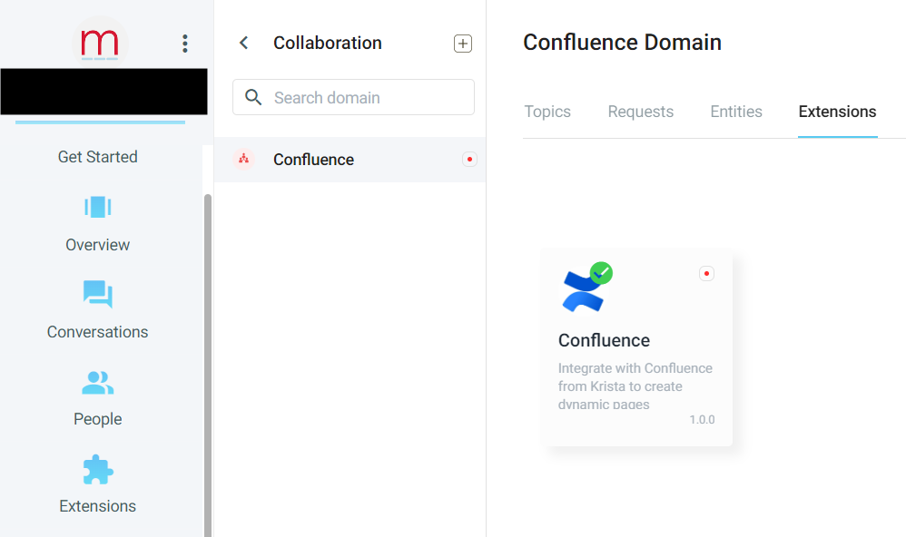
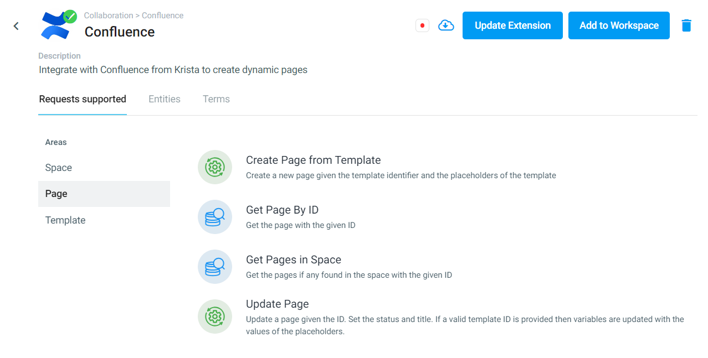
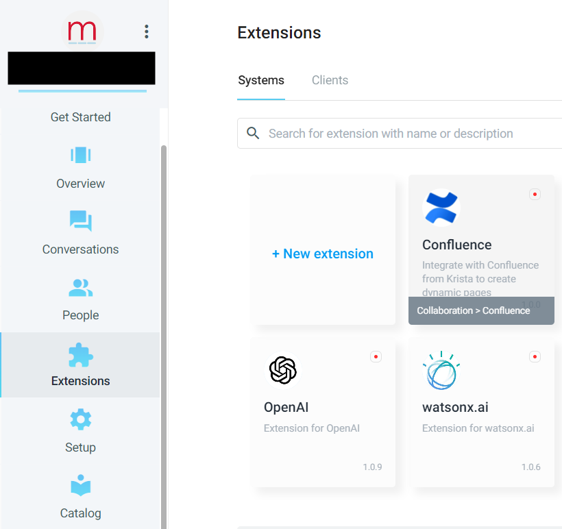
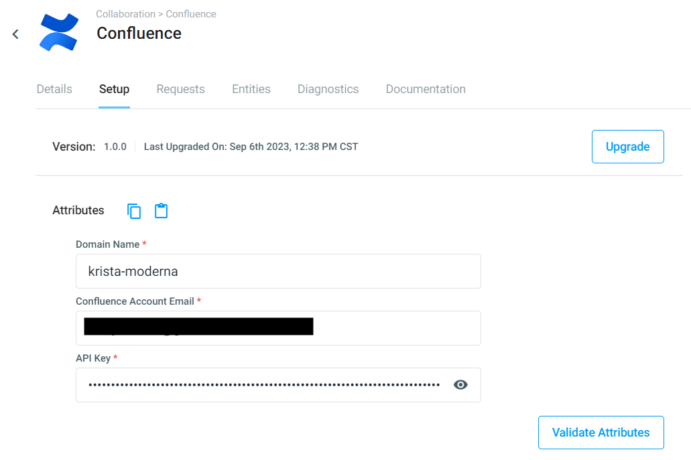
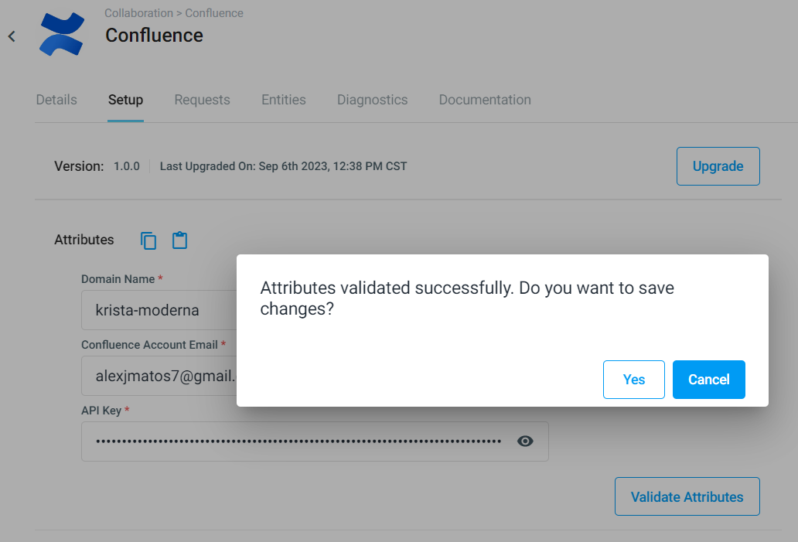

## How to configure the Confluence extension in Krista

The Confluence extension supports two authentication methods: **OAuth 2.0** and **Basic Auth (API Token)**. Choose ONE method only.

### Option A: OAuth 2.0 Setup (Recommended)

#### Step 1
Select the Confluence Extension which is present in Catalog -> Collaboration -> Confluence -> Extensions -> Confluence Extension

#### Step 2
Click on the Confluence extension and select "Add to Workspace" to add an
invoker to the extensions section. Once it is done, click on Extensions
in the left navigation bar.

#### Step 3
Find the Confluence extension. Navigate to the tab "Setup", then click on upgrade.

To set up OAuth 2.0 authentication:
1. First, create an OAuth 2.0 app in the [Atlassian Developer Console](https://developer.atlassian.com/console/myapps/) — see [Getting OAuth 2.0 Credentials](pages/GettingOAuth2Credentials.md) for detailed steps
2. Enter the **Client Id** and **Client Secret** from your OAuth app
3. Leave the Domain Name, Account Email, and API Key fields **empty**
4. Click **Validate Attributes**
5. A popup will open — sign in and authorize the app
6. After seeing "Authentication successful", close the popup
7. Click **Validate Attributes** again to verify the connection

Now you are ready to use the requests and consume data hosted in your Confluence environment.

---

### Option B: Basic Auth (API Token) Setup

#### Step 1
Select the Confluence Extension which is present in Catalog -> Collaboration -> Confluence -> Extensions -> Confluence Extension

#### Step 2
Click on the Confluence extension and select "Add to Workspace" to add an
invoker to the extensions section. Once it is done, click on Extensions
in the left navigation bar.

#### Step 3
Find the Confluence extension. Navigate to the tab "Setup", then click on upgrade.
Now it is time to set the attributes. Enter the domain name of your Confluence environment,
it is found in the URL: https://{domain_name}.atlassian.net/wiki/home where domain name
in our case is "krista-moderna". Next enter the account email used to create the API Key
or another account email with privileges for admin or product owner in Confluence.
Finally, enter the API Key generated in this [section](confluence.md). Click on validate attributes
to finish the set-up.

Now you are ready to use the requests and consume data hosted in your Confluence environment.
