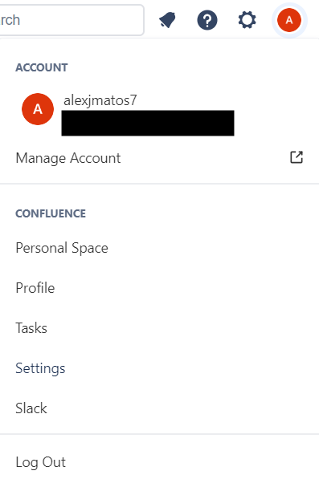
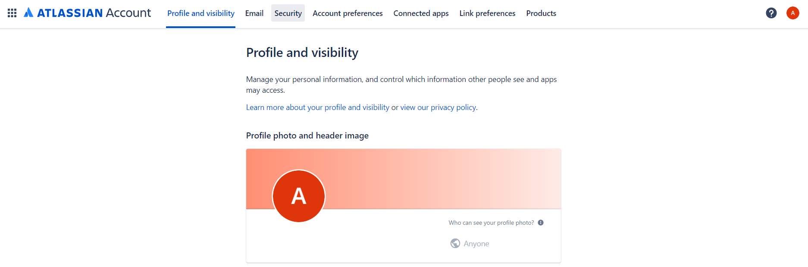
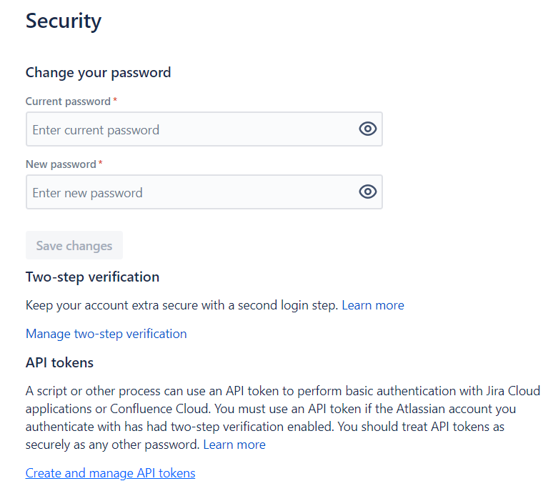
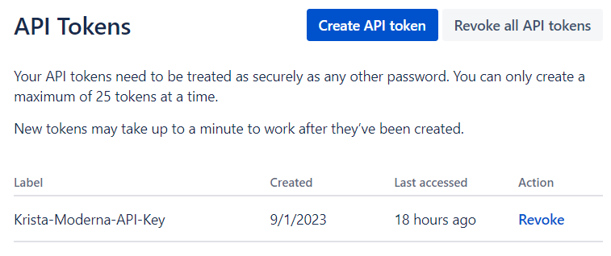

## How to generate an API Key in Confluence

For using the extension and accessing the information from the environment, an API Key is needed.
In this section it is explained the process to generate a new one or use an existing one.

### 1. Manage account options

Navigate to the main page for the confluence cloud environment, login if needed and click in the 
top right corner to view the options for your account. Click on "Manage Account".

### 2. Security section

Once the manage account section is loaded, click on the security section at the top center to view
all options related to passwords, two-step verification and api tokens.

### 2. Generate API Key or use an existing one

Click on "Create and manage API Tokens", then click on "Create API Token". 
Give it a meaningful name related to the operation, extension or client and then
save this API Key safe because it is going to be used in the following section for
setting up the confluence extension.

