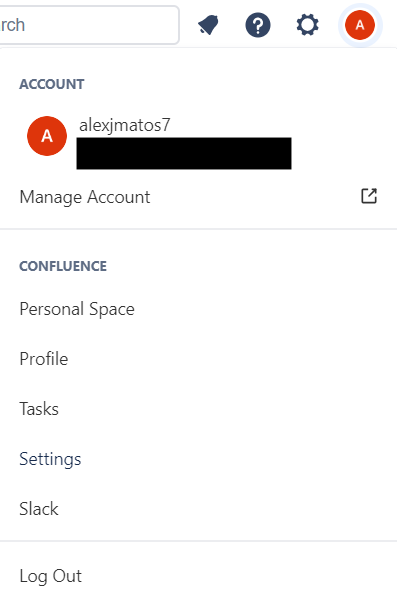
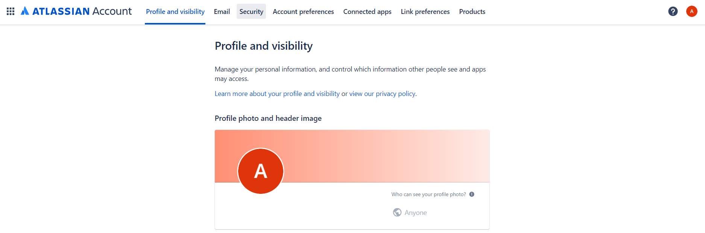
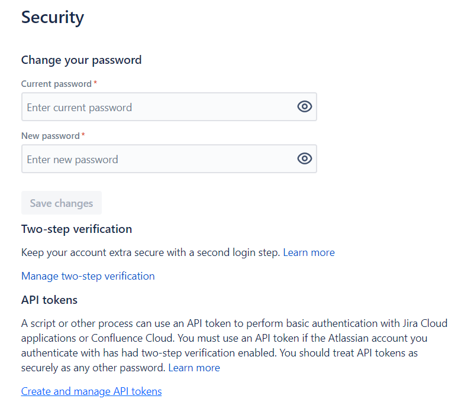
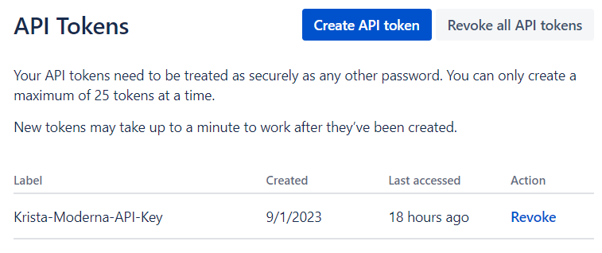

# Creating Confluence App (API Token Generation)

## Overview

This guide provides step-by-step instructions for generating an API token in Atlassian Confluence Cloud. The API token is required to authenticate the Confluence Extension and enable secure access to your Confluence environment.

## Prerequisites

- Active Atlassian Confluence Cloud account
- Access to Atlassian account management
- Admin or appropriate permissions in Confluence

## Step-by-Step Instructions

### Step 1: Access Manage Account Options

1. Navigate to your Confluence Cloud environment
2. Log in if prompted
3. Click on your profile icon in the top-right corner
4. Select **Manage Account** from the dropdown menu



> **💡 Tip**: The Manage Account option redirects you to your Atlassian account settings, which is shared across all Atlassian products (Confluence, Jira, etc.).

### Step 2: Navigate to Security Section

1. Once in the account management page, locate the top navigation menu
2. Click on the **Security** tab
3. The Security section displays options for:
   - Password management
   - Two-step verification
   - API tokens
   - Connected apps



> **📝 Note**: If you don't see the Security tab, you may not have sufficient permissions. Contact your Atlassian administrator.

### Step 3: Access API Token Management

1. In the Security section, scroll down to find **API tokens**
2. Click on **Create and manage API tokens**
3. You'll see a list of existing API tokens (if any)
4. Each token displays:
   - Token name
   - Creation date
   - Last used date



> **⚠️ Warning**: Treat API tokens like passwords. Anyone with your token can access your Confluence data with your permissions.

### Step 4: Generate New API Token

1. Click the **Create API token** button
2. A dialog box will appear prompting for a token name
3. Enter a descriptive name for the token:
   - Example: "Krista Extension - Production"
   - Example: "Confluence Automation - Dev"
4. Click **Create**



> **💡 Tip**: Use descriptive names that indicate the purpose and environment. This makes it easier to manage multiple tokens.

### Step 5: Copy and Secure the Token

1. After creation, the token will be displayed **once**
2. Click the **Copy** button to copy the token to your clipboard
3. **Important**: Save the token immediately in a secure location
4. You cannot view the token again after closing this dialog
5. If you lose the token, you must generate a new one

**Token Format Example:**
```
REDACTED_SECRET
```

> **⚠️ Critical**: This is the only time you'll see the complete token. Store it securely before closing the dialog.

### Step 6: Store Token Securely

**Recommended Storage Options:**

1. **Password Manager** (Recommended)
   - 1Password
   - LastPass
   - Bitwarden
   - Dashlane

2. **Secure Notes**
   - Encrypted note-taking apps
   - Secure company documentation system

3. **Environment Variables** (for scripts)
   - Store in `.env` files (not committed to version control)
   - Use secret management systems

**DO NOT:**
- ❌ Store in plain text files
- ❌ Share via email or chat
- ❌ Commit to version control (Git, SVN, etc.)
- ❌ Display in screenshots or documentation

## Token Management Best Practices

### Naming Conventions

Use clear, descriptive names:

```
✅ Good Examples:
- "Krista Extension - Production"
- "Krista Extension - Development"
- "Confluence Automation - Team Marketing"
- "API Integration - Reporting System"

❌ Poor Examples:
- "Token 1"
- "Test"
- "My Token"
- "Temp"
```

### Token Organization

For multiple environments:

| Environment | Token Name | Purpose |
|-------------|------------|---------|
| Production | "Krista Extension - Prod" | Live system integration |
| Staging | "Krista Extension - Staging" | Testing before production |
| Development | "Krista Extension - Dev" | Development and testing |

### Token Rotation

**Recommended Schedule:**
- **Production**: Every 90 days
- **Development**: Every 180 days
- **Immediately**: If compromised or suspicious activity

**Rotation Process:**
1. Generate new token with updated name (e.g., add date)
2. Update extension configuration
3. Test new token
4. Revoke old token
5. Document rotation in change log

## Verification

### Verify Token Creation

After generating the token:

1. ✅ Token appears in your API tokens list
2. ✅ Token name is descriptive and clear
3. ✅ Token is copied and stored securely
4. ✅ Creation date is correct

### Test Token

Before using in production:

1. Configure the token in a test environment
2. Run a simple API call (e.g., Get Spaces)
3. Verify successful authentication
4. Check that appropriate data is returned

## Revoking Tokens

### When to Revoke

Revoke tokens immediately if:
- Token is compromised or exposed
- Integration is decommissioned
- Employee leaves the organization
- Token is no longer needed
- Suspicious activity is detected

### How to Revoke

1. Navigate to **Manage Account** → **Security**
2. Click **Create and manage API tokens**
3. Find the token to revoke
4. Click the **Revoke** button next to the token
5. Confirm revocation

> **📝 Note**: Revoked tokens cannot be restored. You must generate a new token if needed.

## Troubleshooting

### Issue: "Cannot Create API Token"
**Cause**: Insufficient account permissions

**Resolution:**
1. Verify you have an active Atlassian account
2. Check that your account is not restricted
3. Contact your Atlassian administrator
4. Ensure you're logged into the correct account

### Issue: "Token Not Working"
**Cause**: Token copied incorrectly or expired

**Resolution:**
1. Verify you copied the complete token (no spaces or line breaks)
2. Check that the token hasn't been revoked
3. Regenerate token if necessary
4. Ensure you're using the correct email address

### Issue: "Lost Token"
**Cause**: Token not saved after generation

**Resolution:**
1. You cannot retrieve a lost token
2. Revoke the old token for security
3. Generate a new token
4. Save the new token securely immediately

### Issue: "Too Many Tokens"
**Cause**: Multiple tokens created over time

**Resolution:**
1. Review all active tokens
2. Identify unused or old tokens
3. Revoke tokens that are no longer needed
4. Maintain only necessary tokens

## Security Considerations

### Token Security

**Treat API tokens like passwords:**
- Never share tokens
- Store securely
- Rotate regularly
- Revoke when not needed
- Monitor usage

### Account Security

**Protect your Atlassian account:**
- Enable two-factor authentication
- Use strong, unique password
- Monitor account activity
- Review connected apps regularly
- Keep recovery email updated

### Audit and Monitoring

**Regular Reviews:**
- Monthly: Review active tokens
- Quarterly: Rotate production tokens
- Annually: Audit all integrations
- Immediately: Investigate suspicious activity

## Next Steps

After generating your API token:

1. **Configure the Extension**
   - Follow the [Extension Configuration](pages/ExtensionConfiguration.md) guide
   - Enter your domain name, email, and API token
   - Validate the configuration

2. **Test the Connection**
   - Run a simple catalog request
   - Verify successful authentication
   - Confirm data retrieval

3. **Set Up Your Workflows**
   - Explore available catalog requests
   - Build automation workflows
   - Integrate with your processes

## See Also

- [Extension Configuration](pages/ExtensionConfiguration.md) - Configure the extension
- [Authentication](pages/Authentication.md) - Authentication details
- [Get Spaces](pages/GetSpaces.md) - Test your configuration
- [Atlassian API Tokens Documentation](https://support.atlassian.com/atlassian-account/docs/manage-api-tokens-for-your-atlassian-account/) - Official guide

