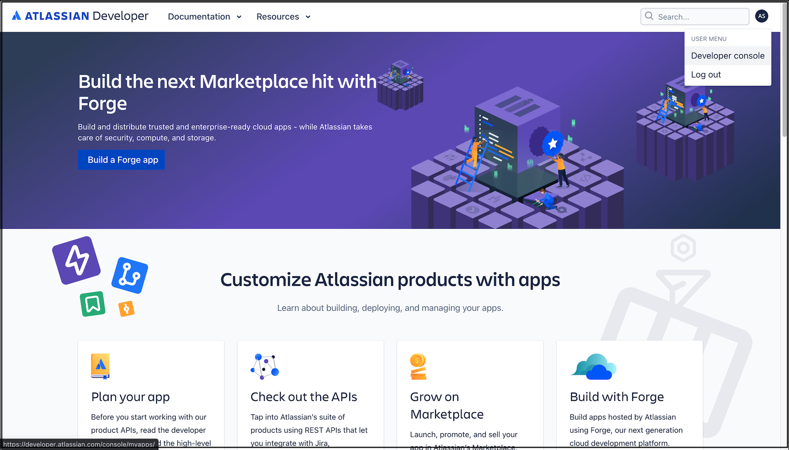
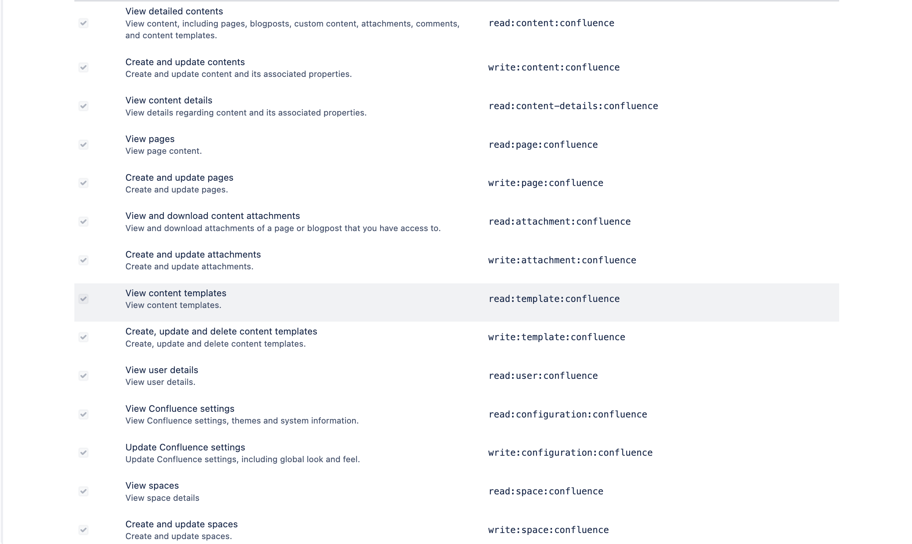
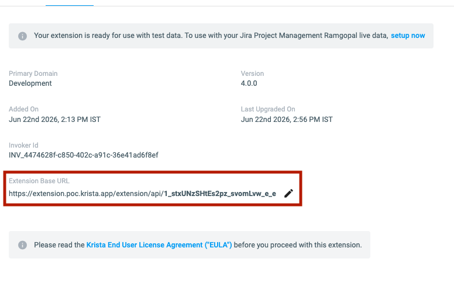
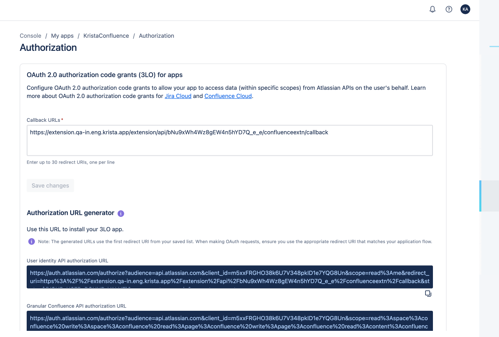
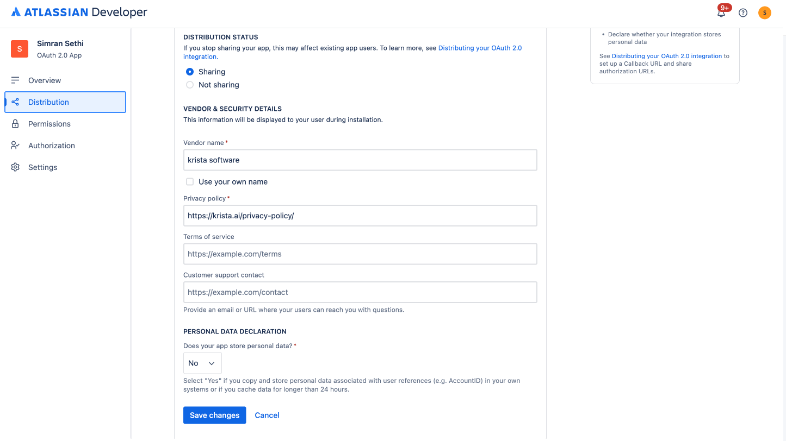

# Getting OAuth 2.0 Credentials

## Overview

This guide provides step-by-step instructions for creating an OAuth 2.0 app in the Atlassian Developer Console and obtaining the Client ID and Client Secret required for OAuth authentication with the Confluence Extension.

## Prerequisites

- Atlassian account with administrator access
- Access to the Atlassian Developer Console

## Step-by-Step Instructions

### Step 1: Create OAuth 2.0 App

1. Go to the Atlassian Developer Console: [https://developer.atlassian.com/console/myapps/](https://developer.atlassian.com/console/myapps/)

   

2. Click **Create** → **OAuth 2.0 integration**
3. Enter a name for your app (e.g., "Krista Confluence Integration")
4. Click **Create**

### Step 2: Configure Permissions

1. In your newly created app, click on the **Permissions** tab
2. You will see different API sections. Configure the following:

#### User Identity API

Click **Edit Scopes** on the User Identity API panel and select:
- `View active user profile`

Click **Save**.

#### Confluence API

Go to the **Confluence API** section. Click **Edit Scopes** and add the following **granular scopes**:

| Scope | Description |
|-------|-------------|
| `read:content:confluence` | View detailed contents |
| `write:content:confluence` | Create and update contents |
| `read:content-details:confluence` | View content details |
| `read:page:confluence` | View pages |
| `write:page:confluence` | Create and update pages |
| `read:attachment:confluence` | View and download content attachments |
| `write:attachment:confluence` | Create and update attachments |
| `read:template:confluence` | View content templates |
| `write:template:confluence` | Create, update and delete content templates |
| `read:user:confluence` | View user details |
| `read:configuration:confluence` | View Confluence settings |
| `write:configuration:confluence` | Update Confluence settings |
| `read:space:confluence` | View spaces |
| `write:space:confluence` | Create and update spaces |



Click **Save**.

> **Important:** Make sure you are adding **granular scopes** (e.g., `read:space:confluence`), not classic scopes (e.g., `read:confluence-space.summary`). The Confluence REST API v2 requires granular scopes.

### Step 3: Configure Callback URL

1. Click on the **Authorization** tab
2. Click **Configure** (or **Add**)
3. For the Callback URL, use your **Extension Base URL** (found on the extension's details page in Krista) with `/confluenceextn/callback` appended:

   **Format:**
   ```
   {Extension Base URL}/confluenceextn/callback
   ```

   **Example:**
   ```
   https://extension.poc.krista.app/extension/api/1_stxUNzSHtEs2pz_svomLvw_e_e/confluenceextn/callback
   ```

   To find your Extension Base URL, go to the extension's details page in Krista:

   

4. Click **Save**

   

### Step 4: Get Client ID and Client Secret

1. Click on the **Settings** tab
2. Scroll down to the **Authentication details** section
3. Copy the **Client ID** and **Client Secret**

   

4. Store both values securely — the Client Secret is only shown once

> **Warning:** Treat the Client Secret like a password. Never share it via email or chat, and never commit it to version control.

### Step 5: Enable Distribution (Allow Other Users to Authorize)

When your app is first created, only the app creator can authorize. To allow other users, enable sharing through the **Distribution** tab:

1. Open the **Distribution** tab in your app
2. Fill in the required fields:
   - **Vendor name**: Your organization or company name
   - **Privacy policy URL**: A publicly accessible URL to your organization's privacy policy
3. Click **Save**

   

4. Toggle **Enable sharing** to **ON**

Once sharing is enabled, any Atlassian user can authorize the app through the normal OAuth flow.

---

## Troubleshooting

### Popup keeps appearing on every Test Connection click

Check:
1. **Callback URL mismatch**: The callback URL must exactly match `{Extension Base URL}/confluenceextn/callback`
2. **Popup blocked**: Ensure your browser is not blocking popups for the Krista platform
3. **Permissions missing**: Verify all required scopes are configured in the Atlassian Developer Console

### Error: "Unauthorized; scope does not match"

Verify you added **granular scopes** (not classic scopes) in the Developer Console. After updating scopes, re-authorize by clearing credentials, saving, re-entering them, and clicking Test Connection again.

## See Also

- [Extension Configuration](ExtensionConfiguration.md) - Setup guide
- [Authentication](Authentication.md) - Authentication overview
- [Creating Confluence App (API Token)](CreatingConfluenceApp.md) - API token generation guide
